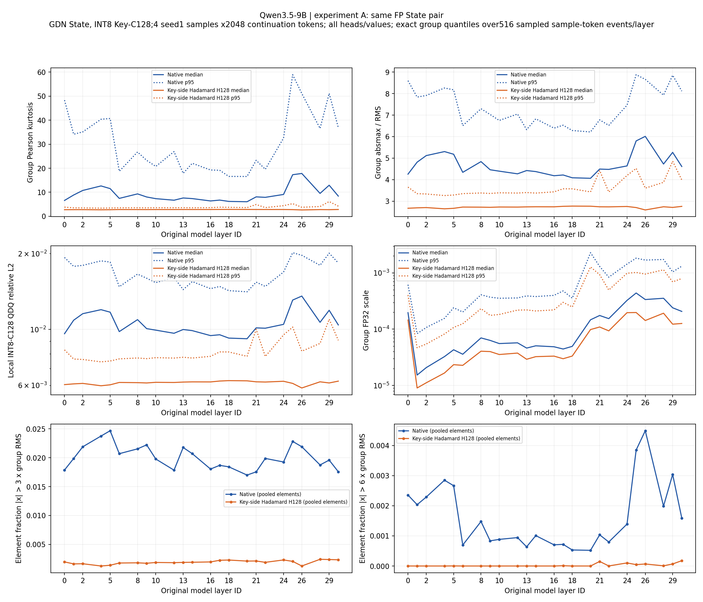
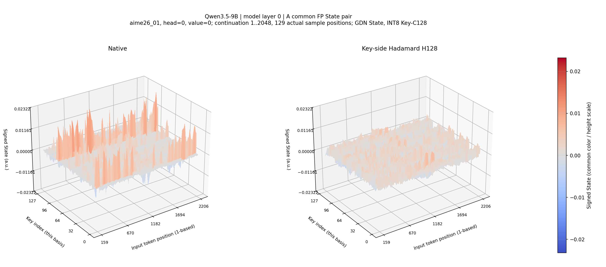

# Learned Rotation Quantization — GDN State 实测归档

本仓库当前收录 **Qwen3.5-9B GDN State 异常值分布与 Key-side H128 / C128 INT8 测试**（2026-11-02，服务器 .29，物理 GPU4 / RTX 3090）。这是固定 Hadamard 变换的观测实验，没有训练 learned rotation。

**实验 A = PASS；实验 B = PASS。** 完整结果共 **1,677 个文件，13,841,587,619 bytes**。报告、全部最终图片、汇总 CSV、切片矩阵、代码与审核记录在 Git 中；384 个较大的逐组原始统计文件在本仓库 [Release](https://github.com/pytenter/learned-rotation-quantization/releases/tag/qwen35-9b-gdn-state-h128-c128-20261102) 中。

## 从这里开始

- [完整中文报告](results/2026-11-02-qwen35-9b-gdn-state-h128-c128/REPORT_zh_FINAL.md)
- [数据字典与统计口径](results/2026-11-02-qwen35-9b-gdn-state-h128-c128/DATA_DICTIONARY_zh.md)
- [逐层结果](results/2026-11-02-qwen35-9b-gdn-state-h128-c128/analysis/per_layer_summary.csv) · [逐头结果](results/2026-11-02-qwen35-9b-gdn-state-h128-c128/analysis/per_layer_head_summary.csv) · [逐 token 结果](results/2026-11-02-qwen35-9b-gdn-state-h128-c128/analysis/per_token_layer_summary.csv)
- [严格配对逐组改善比例](results/2026-11-02-qwen35-9b-gdn-state-h128-c128/analysis/A_paired_group_effects.csv) · [异常组位置](results/2026-11-02-qwen35-9b-gdn-state-h128-c128/analysis/high_outlier_groups.csv)
- [实验 A 全部图](results/2026-11-02-qwen35-9b-gdn-state-h128-c128/figures/A) · [实验 B 全部图](results/2026-11-02-qwen35-9b-gdn-state-h128-c128/figures/B)
- [运行环境与复现说明](REPRODUCIBILITY.md) · [数据下载与完整性校验](#下载完整原始数据)

## 测了什么

| 实验 | 真实对象 | 比较口径 |
|---|---|---|
| A | 同一条 FP32 reference State 的 Native 与 `HᵀS` 快照 | 同 sample / token / head / value 严格配对；QDQ 仅用于观测 |
| B | 两条独立递推的 Native / H128 轨迹，持久 State 真正使用 INT8 codes + FP32 scales | 相同 teacher-forced tokens，内部状态可分叉；并非同一 State 的配对比较 |

固定选取既有 seed1 FP token 轨迹的前四题，每题 2,048 continuation tokens；没有生成新答案、评分或训练。覆盖全部 24 个 GDN 层、32 heads、128 value channels，以及每组 Key 轴的全部 128 元素。每题采样 129 个位置。最终主图共 146 张，旧版图与失败记录也保留。

在本次覆盖范围内，A、B 的全部 24 层均观察到 H128 的 median 峰均比、Pearson 峰度、scale 和局部 INT8 QDQ 相对 L2 误差降低。A 严格配对后，各层误差改善的 group 占 **90.10%–99.08%**，仍有 group 变差。异常值随层深不呈严格单调变化。这里的结果不构成准确率、自由生成质量或长期稳定性结论。





3D 图为第一题的固定 head0/value0 切片，不代表全层。全层结论来自完整逐组统计。B 图中的 CACHE 值由相同写回源调用纯 encode/decode 重建；其数值等价是代码验证，物理 INT8 bank 的字段、字节和读取路径是运行验证，二者证据范围不同。

## 下载完整原始数据

```bash
git clone https://github.com/pytenter/learned-rotation-quantization.git
cd learned-rotation-quantization
python3 scripts/fetch_raw_data.py
python3 scripts/verify_delivery.py
```

下载脚本只使用 Python 标准库，从同仓库 Release 下载 8 个 TAR 文件，每个小于 2 GiB。它先检查每个 TAR 的 SHA256，再检查其中每个原始文件的名称、大小与 SHA256，最后还原到 `results/2026-11-02-qwen35-9b-gdn-state-h128-c128/formal/{A,B}/groups/`。下载量约 13.6 GB；保留压缩包和解包文件时需约 27.3 GB 空间。可用 `--remove-archives` 在每个包验证、解包后删除本地 TAR。

也可在 [Release 页面](https://github.com/pytenter/learned-rotation-quantization/releases/tag/qwen35-9b-gdn-state-h128-c128-20261102) 手动下载；资源路径、精确大小和哈希见 [RELEASE_ASSETS.json](RELEASE_ASSETS.json)。完整发布文件清单见 [PUBLICATION_MANIFEST.sha256](PUBLICATION_MANIFEST.sha256)。

## 工件与证据保留

原交付的 `MANIFEST.sha256`、`DOCUMENTATION_MANIFEST.sha256` 及所有文件保持原字节。`REPORT_zh_FINAL.md` 是推荐的文档修正版；原报告、预采集失败、量化参考浮点口径修正和旧图布局均保留。报告中“未推送”的文字描述实验结束时的历史状态；本仓库发布发生在用户随后授权上传之后。

原始科学仓库为 [pytenter/GDN-quantization](https://github.com/pytenter/GDN-quantization)，本次记录的基础 commit 为 `b2b8467b4d0733425c4fcc8feff25f3d0aed7d33`。这里不包含模型权重、Python 环境或编译缓存；依赖与上游材料的许可仍按各自来源处理。

完整发布后的核验结果见 [PUBLICATION_VERIFICATION.json](PUBLICATION_VERIFICATION.json)。
