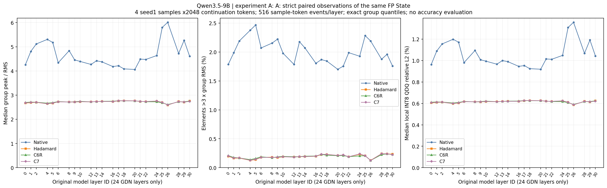
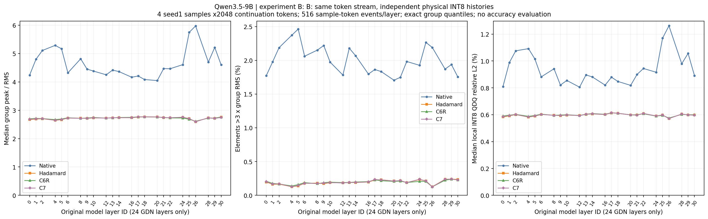

# Learned Rotation Quantization — GDN State 实测归档

本仓库收录 Qwen3.5-9B GDN recurrent State 的分布、旋转与物理 INT8 缓存实验。最新结果为 **Native / Hadamard / C6R / C7 四配置对比（2026-11-03）**；此前的 Native/H128 实验继续保留。

| 日期 | 实验 | 报告 | 原始数据 |
|---|---|---|---|
| 2026-11-03 | 四旋转：同 FP State 严格配对与独立物理 INT8 递推 | [中文报告](results/2026-11-03-qwen35-9b-gdn-state-c6r-c7/REPORT_zh.md) · [结论速览](results/2026-11-03-qwen35-9b-gdn-state-c6r-c7/RESULTS_AT_A_GLANCE_zh.md) | [34 分卷 Release](https://github.com/pytenter/learned-rotation-quantization/releases/tag/qwen35-9b-gdn-state-c6r-c7-20261103) |
| 2026-11-02 | Native / 固定 H128，Key-side C128 INT8 | [原报告](results/2026-11-02-qwen35-9b-gdn-state-h128-c128/REPORT_zh_FINAL.md) · [原发布说明](README_20261102.md) | [原 8 分卷 Release](https://github.com/pytenter/learned-rotation-quantization/releases/tag/qwen35-9b-gdn-state-h128-c128-20261102) |

## 最新实验：范围和主要结果

**A、B 的四种配置均为 PASS。** 使用与上一轮相同的4道题、既有 seed1 FP token 轨迹，逐题回放完整 prompt 和前2,048个 continuation tokens；每题采样129个位置，覆盖全部24个 GDN 层、32 heads、128 values及完整128维 Key 轴。8个全注意力层不计入 GDN State。没有新自由生成、准确率评测或训练。

| 实验 | 实际观察对象 | 比较口径 |
|---|---|---|
| A | 同一个 FP32 reference State 分别变换为 Native / Hadamard / C6R / C7 | sample/token/layer/head/value严格配对；QDQ只观测，不写回参考 |
| B | 从prompt首token开始，每步真正写入INT8 codes和FP32 scales，下步从自身缓存恢复 | 同token输入的四条独立递推；内部State和隐藏输入会分叉 |

C6R/C7使用历史正式评测实际绑定的冻结导出，分别为update94/exposure752、update19/exposure152。有效变换是H128与学习Delta的组合；已核验方向、归一化先后、head共享和正交性，没有重训、重选或QR/SVD重正交化。

**两种学习旋转后仍有outlier，并非所有层都优于Hadamard。** 下表是24层按实际元素数加权的比例，采用严格`>3×本组RMS`：

| 实验 | Native | Hadamard | C6R | C7 |
|---|---:|---:|---:|---:|
| A：outlier元素比例 | 2.008863% | 0.192578% | 0.193839% | 0.194084% |
| B：outlier元素比例 | 2.003989% | 0.193078% | 0.193929% | 0.194216% |

- C6R对极端`>6×RMS`尾部改善较明显：A中计数93,589，Hadamard为171,007；B中分别为93,138和164,851。
- 相比Hadamard，局部QDQ误差median更低的层数：A中C6R为8/24、C7为7/24；B中分别为5/24、7/24。完整层ID和四道题各自的配对结果见报告与CSV。
- 峰均比通常与局部INT8误差密切相关，但排名不完全一致。实际舍入还取决于元素在量化格点的位置，尾部计数较少不必然意味着误差更低。
- Native/Hadamard与上一轮对照的1,152个汇总数值字段精确一致；不扩称所有历史原始张量相同。

独立题目仅4个，token/head/value/group均为重复观察。本结果不构成统计显著、普遍最优、准确率或长期稳定性结论。





## 报告、图表和证据

- [中文报告](results/2026-11-03-qwen35-9b-gdn-state-c6r-c7/REPORT_zh.md) · [结论速览与解释](results/2026-11-03-qwen35-9b-gdn-state-c6r-c7/RESULTS_AT_A_GLANCE_zh.md) · [数据字典](results/2026-11-03-qwen35-9b-gdn-state-c6r-c7/DATA_DICTIONARY_zh.md)
- [逐层](results/2026-11-03-qwen35-9b-gdn-state-c6r-c7/analysis/per_layer_summary.csv) · [逐头](results/2026-11-03-qwen35-9b-gdn-state-c6r-c7/analysis/per_layer_head_summary.csv) · [逐题](results/2026-11-03-qwen35-9b-gdn-state-c6r-c7/analysis/per_sample_layer_summary.csv) · [A严格配对](results/2026-11-03-qwen35-9b-gdn-state-c6r-c7/analysis/A_paired_group_effects.csv) · [高异常组位置](results/2026-11-03-qwen35-9b-gdn-state-c6r-c7/analysis/high_outlier_groups.csv)
- [A全部50张主图](results/2026-11-03-qwen35-9b-gdn-state-c6r-c7/figures/A) · [B全部50张主图](results/2026-11-03-qwen35-9b-gdn-state-c6r-c7/figures/B) · [全图视觉检查](results/2026-11-03-qwen35-9b-gdn-state-c6r-c7/visual_qa)
- [96行矩阵身份](results/2026-11-03-qwen35-9b-gdn-state-c6r-c7/provenance/MATRIX_IDENTITY.csv) · [正式checkpoint绑定](results/2026-11-03-qwen35-9b-gdn-state-c6r-c7/provenance/FORMAL_CHECKPOINT_USE_EVIDENCE.json) · [独立数据复核](results/2026-11-03-qwen35-9b-gdn-state-c6r-c7/analysis/INDEPENDENT_DATA_REVIEW.json)
- [发布布局与完整性](results/2026-11-03-qwen35-9b-gdn-state-c6r-c7/PUBLICATION_README.md) · [环境及复绘说明](REPRODUCIBILITY.md)

Key图展示全部32 heads×128 Keys；不同基底下相同Key编号不自动代表同一原始语义特征。B主误差以更新后、写入前的FP32临时State计算；另存从真实INT8 bank字段读取的缓存Key汇总。

## 本轮完整数据下载（可选）

阅读报告、图表和主要汇总无需下载大数据。逐组指标、逐Key时间汇总、验证NPZ及逐token明细放在同仓库Release，全部保持原字节。

```bash
git clone https://github.com/pytenter/learned-rotation-quantization.git
cd learned-rotation-quantization

# 只验证已克隆的321个原始工件，不下载数据
python3 scripts/verify_release_data.py --git-only

# 需要完整数据时再运行；每包验证并解包后删除下载缓存
python3 scripts/fetch_release_data.py --remove-archives
python3 scripts/verify_release_data.py
```

34个TAR均小于2GiB：32包分别为A/B × 四方法 × 四题，每包含24层逐组指标和24层逐Key汇总；另2包为验证NPZ与逐token表/事件日志。下载约29.87GB，逐包删除缓存时约需31GB空间；保留所有缓存和解包文件时约需60GB。支持`--asset 精确文件名`选择单包。精确大小、成员和SHA见[本轮RELEASE_ASSETS.json](results/2026-11-03-qwen35-9b-gdn-state-c6r-c7/RELEASE_ASSETS.json)。

下载器先校验TAR，再核对每个成员的路径、长度和SHA；完整校验器检查2,638个原始交付文件，含2,636个主清单成员及清单/完成回执本身。只用Python标准库，不加载模型或GPU。旧命令`scripts/fetch_raw_data.py`和`scripts/verify_delivery.py`仍对应2026-11-02实验，保持兼容。

## 工件保留

`.29`服务器原始结果和封存清单继续保留。本仓库是随后获用户授权的发布副本；原报告“不自动推送”等文字描述实验结束时的边界，原文件不因此改写。失败、首版图及独立CPU排版修复记录均保留。

包含实际使用的小型旋转checkpoint；不包含基础模型权重、Python环境或编译缓存。上游科学代码来自[pytenter/GDN-quantization](https://github.com/pytenter/GDN-quantization)，依赖及上游材料按各自来源许可处理。


[本轮完整发布核验](results/2026-11-03-qwen35-9b-gdn-state-c6r-c7/PUBLICATION_VERIFICATION.json)：34个数据TAR及SHA256SUMS已逐项核对GitHub服务器的大小和SHA256，全部通过。
