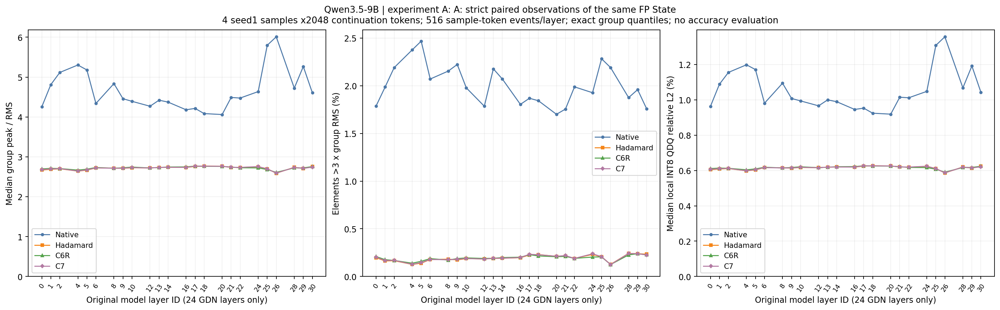
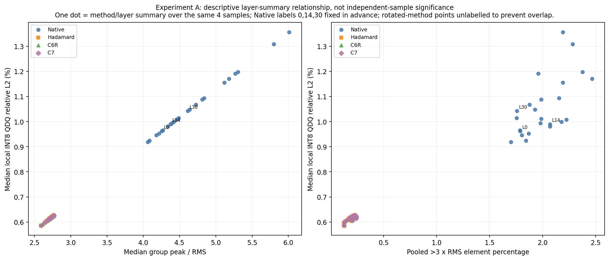
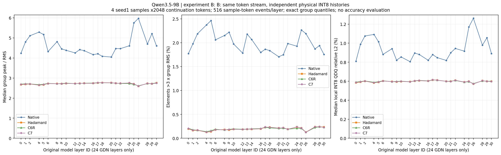
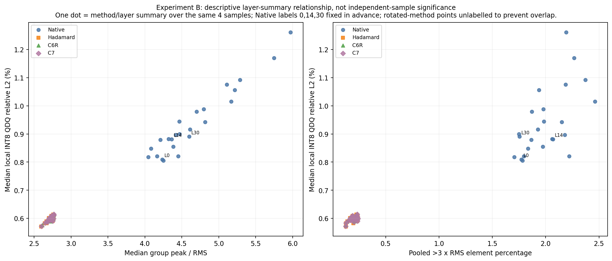

# Qwen3.5-9B GDN State：Native / Hadamard / C6R / C7 实测对比

实验日期：2026-11-03，北京时间；.29物理GPU4，RTX3090。仅State分布与真实INT8机制观察，没有新AIME自由生成、准确率评分或训练。

## 直接回答

**实验A：四配置均PASS；实验B：四配置均PASS。**

**1. 旋转后是否仍存在outlier？**

**C6R旋转后仍存在按本组RMS定义的outlier**：A中>3×RMS元素观察12,585,539个（24/24层），>6×RMS为93,589个（12/24层）；B中>3×RMS元素观察12,591,416个（24/24层），>6×RMS为93,138个（13/24层）。这些是重复元素观察数，不是独立题目数。

**C7旋转后仍存在按本组RMS定义的outlier**：A中>3×RMS元素观察12,601,439个（24/24层），>6×RMS为163,868个（15/24层）；B中>3×RMS元素观察12,610,001个（24/24层），>6×RMS为155,927个（15/24层）。这些是重复元素观察数，不是独立题目数。

**2. 与Hadamard相比，分别在哪些层更好或更差？** 不预设学习旋转总是更好。前两组直接对照Hadamard，第三组直接比较C7与C6R。下表“低”表示候选的该具体指标更小：峰均比更不突出、比例更少或局部误差更小；三个指标分别判断。

|实验|候选/参照|指标|候选更低的层ID|候选更高的层ID|相同层ID|
|---|---|---|---|---|---|
|A|C6R/Hadamard|峰均比median|8,12,18,20,22,24,25,28,30|0,1,2,4,5,6,9,10,13,14,16,17,21,26,29|无|
|A|C6R/Hadamard|>3RMS元素比例|8,18,20,21,24,25,26,28,30|0,1,2,4,5,6,9,10,12,13,14,16,17,22,29|无|
|A|C6R/Hadamard|局部QDQ误差median|8,12,18,20,22,24,25,28|0,1,2,4,5,6,9,10,13,14,16,17,21,26,29,30|无|
|A|C7/Hadamard|峰均比median|6,8,12,18,25,28,30|0,1,2,4,5,9,10,13,14,16,17,20,21,22,24,26,29|无|
|A|C7/Hadamard|>3RMS元素比例|8,12,18,22,26,28,30|0,1,2,4,5,6,9,10,13,14,16,17,20,21,24,25,29|无|
|A|C7/Hadamard|局部QDQ误差median|8,12,14,18,25,28,30|0,1,2,4,5,6,9,10,13,16,17,20,21,22,24,26,29|无|
|A|C7/C6R|峰均比median|0,1,2,4,5,6,8,9,10,12,14,16,17,21,26,29,30|13,18,20,22,24,25,28|无|
|A|C7/C6R|>3RMS元素比例|0,1,4,5,6,9,10,12,13,14,16,22,30|2,8,17,18,20,21,24,25,26,28,29|无|
|A|C7/C6R|局部QDQ误差median|0,1,2,4,5,6,8,9,10,12,14,16,17,21,26,29,30|13,18,20,22,24,25,28|无|
|B|C6R/Hadamard|峰均比median|8,12,13,18,20,22,24,25,28|0,1,2,4,5,6,9,10,14,16,17,21,26,29,30|无|
|B|C6R/Hadamard|>3RMS元素比例|8,18,20,21,24,25,26,28,29,30|0,1,2,4,5,6,9,10,12,13,14,16,17,22|无|
|B|C6R/Hadamard|局部QDQ误差median|8,22,24,25,28|0,1,2,4,5,6,9,10,12,13,14,16,17,18,20,21,26,29,30|无|
|B|C7/Hadamard|峰均比median|6,8,12,14,18,20,25,28,30|0,1,2,4,5,9,10,13,16,17,21,22,24,26,29|无|
|B|C7/Hadamard|>3RMS元素比例|8,12,18,20,22,26,28,30|0,1,2,4,5,6,9,10,13,14,16,17,21,24,25,29|无|
|B|C7/Hadamard|局部QDQ误差median|8,12,18,21,25,28,30|0,1,2,4,5,6,9,10,13,14,16,17,20,22,24,26,29|无|
|B|C7/C6R|峰均比median|0,1,2,4,5,6,8,9,10,12,14,16,17,21,26,29,30|13,18,20,22,24,25,28|无|
|B|C7/C6R|>3RMS元素比例|0,1,4,5,6,9,10,12,13,14,16,22,26,30|2,8,17,18,20,21,24,25,28,29|无|
|B|C7/C6R|局部QDQ误差median|0,1,2,4,5,6,8,9,10,12,13,14,16,18,20,21,26,29,30|17,22,24,25,28|无|

**3. outlier指标与局部INT8误差排序是否一致？**

A中，四方法的完整峰均比median排序与局部误差median排序在21/24层完全同序；>3RMS比例与误差完整同序为12/24层。包含18个方法对/层的严格相反排序记录；相同outlier指标而误差不同另作相同项处理，不强行称反向。完整差值与方向在`analysis/metric_order_comparison.csv`。

B中，四方法的完整峰均比median排序与局部误差median排序在16/24层完全同序；>3RMS比例与误差完整同序为14/24层。包含25个方法对/层的严格相反排序记录；相同outlier指标而误差不同另作相同项处理，不强行称反向。完整差值与方向在`analysis/metric_order_comparison.csv`。

**4. A与B结论是否一致？** 下表统计方法间比较方向在A/B是否一致；B的状态与隐藏输入已分叉，不能将B差异解释为对同一State只旋转一次的效果。

|候选/参照|指标|A/B同方向层数|不同方向层ID|
|---|---|---|---|
|C6R/Hadamard|peak_rms_median|22|13,30|
|C6R/Hadamard|out3_element_fraction|23|29|
|C6R/Hadamard|qdq_rel_l2_median|21|12,18,20|
|C7/Hadamard|peak_rms_median|22|14,20|
|C7/Hadamard|out3_element_fraction|23|20|
|C7/Hadamard|qdq_rel_l2_median|22|14,21|
|C7/C6R|peak_rms_median|24|无|
|C7/C6R|out3_element_fraction|23|26|
|C7/C6R|qdq_rel_l2_median|20|13,17,18,20|

**5. 哪些来自严格配对？** 严格配对证据来自A。同sample/token/layer/head/value覆盖全部128个Key，下面给出各层候选局部QDQ误差更低的group比例范围；不是四题正确率。B仅是相同teacher-forced输入下的独立递推。

**6. 哪些仍无法判断？** 只有4题、seed1和2048 continuation前缀，不宣称统计显著、普遍最优、完整AIME准确率或长期稳定性。C6R/C7针对历史各自目标训练，不保证以本次outlier或局部量化误差为最优目标；本次未重新训练或重选checkpoint。

|A候选/参照|题目scope|逐层候选误差更低group比例(%)|逐层候选误差更高group比例(%)|
|---|---|---|---|
|C6R/Hadamard|ALL4|44.86–55.79|44.21–55.14|
|C6R/Hadamard|aime26_01|45.88–56.72|43.28–54.12|
|C6R/Hadamard|aime26_02|44.30–55.63|44.37–55.70|
|C6R/Hadamard|aime26_03|45.33–54.55|45.45–54.67|
|C6R/Hadamard|aime26_04|43.81–56.27|43.73–56.19|
|C7/Hadamard|ALL4|46.78–51.65|48.35–53.22|
|C7/Hadamard|aime26_01|47.78–51.46|48.54–52.22|
|C7/Hadamard|aime26_02|45.66–51.73|48.27–54.34|
|C7/Hadamard|aime26_03|47.57–51.46|48.54–52.43|
|C7/Hadamard|aime26_04|45.92–52.52|47.48–54.08|
|C7/C6R|ALL4|43.48–53.35|46.65–56.52|
|C7/C6R|aime26_01|42.37–53.18|46.82–57.63|
|C7/C6R|aime26_02|43.73–53.79|46.21–56.27|
|C7/C6R|aime26_03|44.46–53.26|46.74–55.54|
|C7/C6R|aime26_04|43.37–54.04|45.96–56.63|

## 固定代表层与全部24层

以下层0/14/30在看数据前固定，用作早/中/晚层例子。百分比栏已将CSV比例乘100；peak/RMS无量纲。

|实验|原层ID|方法|peak/RMS median|>3RMS元素(%)|局部QDQ median(%)|Pearson峰度median|
|---|---|---|---|---|---|---|
|A|0|Native|4.2548|1.7878|0.96193|6.5948|
|A|0|Hadamard|2.669|0.19722|0.60428|2.7419|
|A|0|C6R|2.6973|0.20897|0.61084|2.7761|
|A|0|C7|2.68|0.20211|0.60675|2.7521|
|A|14|Native|4.3738|2.0701|0.98936|7.3632|
|A|14|Hadamard|2.7381|0.19112|0.61959|2.8178|
|A|14|C6R|2.7456|0.19825|0.6213|2.8364|
|A|14|C7|2.7382|0.19171|0.61953|2.8187|
|A|30|Native|4.6105|1.758|1.0423|8.4042|
|A|30|Hadamard|2.7561|0.23402|0.62378|2.8308|
|A|30|C6R|2.756|0.22658|0.62402|2.838|
|A|30|C7|2.7419|0.2261|0.62069|2.8185|
|B|0|Native|4.2368|1.7736|0.8095|6.5584|
|B|0|Hadamard|2.6706|0.19711|0.58306|2.7439|
|B|0|C6R|2.6982|0.20797|0.59051|2.7773|
|B|0|C7|2.6811|0.20116|0.58612|2.7535|
|B|14|Native|4.3638|2.0678|0.88125|7.3303|
|B|14|Hadamard|2.7385|0.18987|0.60622|2.8177|
|B|14|C6R|2.7457|0.19721|0.60861|2.8366|
|B|14|C7|2.7385|0.19088|0.60677|2.819|
|B|30|Native|4.6012|1.7539|0.89047|8.3325|
|B|30|Hadamard|2.7592|0.23643|0.59879|2.8385|
|B|30|C6R|2.7608|0.22919|0.59949|2.8446|
|B|30|C7|2.7457|0.22893|0.59604|2.8252|

### A：全部24层局部QDQ误差median（%）

|原层ID|Native|Hadamard|C6R|C7|
|---|---|---|---|---|
|0|0.96193|0.60428|0.61084|0.60675|
|1|1.088|0.60834|0.6136|0.61026|
|2|1.1551|0.61098|0.61254|0.61182|
|4|1.1982|0.59797|0.60377|0.59842|
|5|1.1711|0.60319|0.60896|0.60505|
|6|0.98078|0.61632|0.6185|0.61633|
|8|1.0939|0.61524|0.61442|0.61429|
|9|1.0077|0.61352|0.61689|0.61446|
|10|0.99382|0.61706|0.62085|0.6178|
|12|0.96581|0.61616|0.61595|0.61567|
|13|0.9996|0.61849|0.61868|0.61914|
|14|0.98936|0.61959|0.6213|0.61953|
|16|0.94545|0.61929|0.62205|0.61936|
|17|0.95291|0.62433|0.62677|0.62609|
|18|0.92419|0.6267|0.62533|0.62638|
|20|0.91877|0.62555|0.62469|0.62558|
|21|1.0146|0.61995|0.62154|0.62038|
|22|1.0115|0.61872|0.61714|0.61926|
|24|1.0478|0.623|0.61642|0.62401|
|25|1.308|0.61106|0.60724|0.61085|
|26|1.3567|0.586|0.59062|0.58693|
|28|1.0675|0.61991|0.61658|0.61917|
|29|1.1915|0.61352|0.61725|0.61457|
|30|1.0423|0.62378|0.62402|0.62069|

### B：全部24层局部QDQ误差median（%）

|原层ID|Native|Hadamard|C6R|C7|
|---|---|---|---|---|
|0|0.8095|0.58306|0.59051|0.58612|
|1|0.98796|0.59137|0.5962|0.59349|
|2|1.0755|0.60076|0.60259|0.60142|
|4|1.0918|0.58248|0.58803|0.58317|
|5|1.015|0.58915|0.59415|0.59064|
|6|0.8819|0.60184|0.60408|0.60214|
|8|0.94206|0.59604|0.59537|0.59522|
|9|0.82086|0.5933|0.59744|0.5941|
|10|0.85499|0.59726|0.59992|0.59812|
|12|0.80509|0.59387|0.59413|0.59333|
|13|0.89634|0.60256|0.60417|0.60305|
|14|0.88125|0.60622|0.60861|0.60677|
|16|0.82036|0.60132|0.60334|0.60144|
|17|0.87939|0.61341|0.61483|0.61491|
|18|0.84764|0.6106|0.61104|0.6105|
|20|0.81837|0.59866|0.59892|0.59876|
|21|0.89966|0.59758|0.5998|0.59701|
|22|0.94408|0.60899|0.60734|0.60969|
|24|0.91606|0.59018|0.58947|0.59062|
|25|1.1698|0.59784|0.59521|0.59763|
|26|1.2617|0.57138|0.57531|0.57143|
|28|0.97947|0.60513|0.60246|0.60456|
|29|1.0563|0.59789|0.60009|0.59894|
|30|0.89047|0.59879|0.59949|0.59604|

## 检查点、有效变换与方向

C6R锁定历史update94/exposure752；C7锁定update19/exposure152，未按文件时间或本次结果选择。实际正式canonical60记录两者各60条，逐条核对均绑定下列SHA，见`provenance/FORMAL_CHECKPOINT_USE_EVIDENCE.json`。初始部署工程记录的NOT_FROZEN/失败范围仍保留，不据此冒称旧失败通过；这里使用后续实际正式评测绑定的冻结参数，并进行了本次独立验证。

|配置|实际加载副本绝对路径|文件SHA256|参数布局|
|---|---|---|---|
|C6R|/data/zypan/experiments/QWEN_GDN_STATE_OUTLIER_FOUR_ROTATIONS_C6R_C7_20261103_V1/rotations/C6R/frozen_rotation_fp32.pt|a886588b3613f66e6635e5874dbfaeaee26b850e05b4a1524da0bef952d22da6|每层FP32[128,128] Delta；32 heads共享|
|C7|/data/zypan/experiments/QWEN_GDN_STATE_OUTLIER_FOUR_ROTATIONS_C6R_C7_20261103_V1/rotations/C7/frozen_rotation_fp32.pt|57e7a11714405806385064f07438e5e2ac6b5952dd421606332b894cef3ee6e8|每层FP32[128,128] Delta；32 heads共享|

原参数来自.55迁移备份中的`restored/worktrees/qwen-gdn-c6r-c7-4x3090-deployment-v1/.../rotations/`，副本SHA不变。本次fresh读取的是实际正式评测使用的FP32冻结导出；原A800 theta未在本机重新读取，其路径/SHA及与导出逐层exact一致的原审计保留在导出/选择记录中。正式推理合同是直接加载冻结Delta，不在推理主机重建theta。

实际q/k顺序为：原BF16归一化 → FP32右乘H128 → FP32右乘该层Delta。有效数学变换W=H×Delta；State观察为Deltaᵀ(HᵀS)，恢复为H(DeltaS)。B缓存本来就处于各自旋转坐标，下一步只反量化，不再重复旋转State。Value轴不旋转。C6R/C7并非对称矩阵；Hadamard对称性不能替代转置方向验证。

[逐层矩阵身份表](provenance/MATRIX_IDENTITY.csv)含Native/Hadamard/C6R/C7共96行、原层映射、共享关系、参数与有效矩阵SHA及正交性。`effective_rotations_reference_fp64.npz`的参考W只用于身份/正交性，H和Delta取实际FP32值再转FP64；实际q/k仍是两次FP32 GEMM，不以一次合并矩阵乘法冒充原运算。未进行QR/SVD重新正交化。

|A方法|所有实际group平方L2守恒最大相对误差|
|---|---|
|Native|0|
|Hadamard|6.6215e-07|
|C6R|1.3639e-06|
|C7|1.5403e-06|

真实24层×四方法共96项共同State算子检查，最大读出相对L2误差9.3678e-07，恢复State最大相对误差7.24144e-07；预声明算子阈值2e-5，检查点原正交性阈值1e-4，均未提高。非对称合成Givens的正确方向/错误转置反例、FP64单步对照、独立NumPy全组指标、Key坐标统计、零/非有限值处理见CPU/GPU gates。

## 真实INT8持续写回与内存

第一阶段batch3为A的独立Native FP32 reference与B-Native/B-Hadamard；A对同一参考快照做四方法观察，QDQ不回写参考。第二阶段batch2只有B-C6R/B-C7，完全没有FP reference字段。每题每阶段都从空cache、prompt第一个token开始，所有GDN每步实际写INT8，未使用窗口、跳token量化或高精度B carrier。

每阶段两个B配置是同一批次张量中两个不重叠行，所有规范化/量化归约不跨batch行。实际bank每层codes shape `[2,32,128,128]` INT8、scales `[2,32,1,128]` FP32；下表为每配置一行的逻辑贡献，不能把整块共享storage重复算给每条轨迹。

|每个B配置持久字段|每层一行shape/dtype|24层bytes|
|---|---|---|
|codes|[1,32,128,128] INT8|12,582,912|
|scales|[1,32,1,128] FP32|393,216|
|合计|INT8 + FP32 metadata|12,976,128（12.375MiB）|

每个B配置跨4题共8602输入更新（8192 continuation+410 prompt）、每层8602次写回，合计206,448次layer写回；四配置合计825,792次单配置layer写回。首输入后每层下一步读回从codes×scale恢复，实际pointer检查与计数逐样本保留。缓存兼容槽是字典代理`{0:None}`，不是额外Tensor；A仅持有独立clone的一行FP32，48MiB。B临时FP32解码/更新、FP64观测、CPU memmap统计均不参与下一步持久State。这里按本请求从prompt首token即物理INT8写回，不能将B称为原历史AIME自由生成的完整路径复现；复用的是已确认旋转参数及指定量化口径。

B主误差与主Key图来自写入前更新State；另保存从刚写入的真实bank字段解码的CACHE Key汇总，已区分于上一轮仅同source重建CACHE的证据范围。完整shape/dtype/storage与每层计数见`formal/*/*_RESULT.json`。模型权重、attention KV、GDN卷积、临时scratch及allocator不能忽略后宣称整模型显存缩小4倍。

|资源/时长口径|实际记录|
|---|---|
|CUDA峰值allocated（样本内forward+观测）|19,180,603,392 bytes|
|CUDA峰值reserved（同scope）|19,423,821,824 bytes|
|样本末端attention KV最大观察值|216,858,624 bytes|
|样本末端GDN卷积最大观察值|4,718,592 bytes|
|GPU worker总实际运行时间（含加载/smoke/压缩）|3416.90 s|
|正式forward+观测累计|1300.56 s|
|正式回放加CPU压缩累计|3375.77 s|
|CPU精确汇总和绘图|1154.83 s|

这些时长包含大量采样、同步、D2H、压缩和不同batch布局，不能当成四种方法的公平吞吐benchmark；worker墙钟也不等于GPU实际忙时，未连续测量的GPU active时间不填0。KV只测样本末端，未宣称完整生命周期峰值。实际总文件/bytes见最终`DELIVERY_READY.json`与`MANIFEST.sha256`，不在封存前预填存储量。

## 与上一轮Native/Hadamard对照

模型/tokenizer17个文件fresh SHA、Transformers modeling字节、Torch/Transformers版本、同一GPU4、输入tokens均与上一轮匹配。Native/H阶段保留batch3。对照归档的12个数值字段×96条件/层组合，共1152项，其中1152项数值完全相同，最大相对绝对差0；这是描述性对照，没有临时制造新的PASS容差。

源码核对确认，两轮Hadamard的State观察均为显式matmul(Hᵀ,S)，q/k均在原BF16归一化后FP32右乘H；量化和group_metrics函数保留原字节。不能只凭设计匹配或目录名宣称实际数值完全重复，完整实测差值见`analysis/historical_native_hadamard_comparison.csv`；若出现差异，应继续依据真实输入、dtype、批次和环境证据解释，不编造运算路径变化。

|实验|指标|H/Native方向改变的层ID|
|---|---|---|
|A|peak_rms_median|无|
|A|out3_element_fraction|无|
|A|qdq_rel_l2_median|无|
|B|peak_rms_median|无|
|B|out3_element_fraction|无|
|B|qdq_rel_l2_median|无|

## 数据、图与校验入口

完整列定义、单位、量化和零/相等/分母零规则见[DATA_DICTIONARY_zh.md](DATA_DICTIONARY_zh.md)。逐层、逐头、逐题、逐token、严格A配对及异常组CSV均在`analysis/`。各层分布图`figures/{A,B}/Lxx_distribution.png`，全32head Key图`Lxx_key_outlier_locations.png`；准确作图汇总矩阵在`figure_data/`，原逐Key时间数据在各阶段`key_summaries/`。

GPU worker真实owning Popen.wait整数0，精确epoch退出，own NVML释放；未向其他任务发信号。模型与24项冻结源运行后再次核对通过。独立数据复核见`analysis/INDEPENDENT_DATA_REVIEW.json`，位图检查见`visual_qa/BITMAP_CHECKS.json`；最终本地镜像另逐SHA验证。没有覆盖历史checkpoint、模型或旧实验结果。

最终结论仅覆盖本次4题/seed1/2048前缀的State机制观察，不能外推准确率、其他模型或训练收益。完成后停止，不自动新实验、训练、准确率或推送。
